<div align="center">
  
</div>

<div align="center">
  
</div>

<div align="center">
  <a href="https://git.io/typing-svg">
    
  </a>
</div>

<p align="center">
  <a href="https://github.com/Indermeetsingh20?tab=followers"></a>
  
</p>

## About me

I am a **Full-Stack Developer** with a strong focus on **backend engineering and databases**. I enjoy turning product ideas into dependable systems—from clean interfaces and API contracts to data models, caching strategies, and production-ready services.

```python
developer = {
    "name": "Indermeet Singh",
    "role": "Full-Stack Developer",
    "focus": ["Backend Systems", "APIs", "Databases", "Caching"],
    "building_with": ["FastAPI", "PostgreSQL", "MongoDB", "Redis"],
    "principles": ["clarity", "reliability", "performance", "maintainability"],
}
```

- Building clean, scalable backend services and REST APIs
- Designing relational and document-oriented data models
- Using caching thoughtfully to improve latency and throughput
- Delivering end-to-end applications with a backend-first mindset
- Exploring system design, database performance, and distributed systems

## Core stack

<div align="center">

### Backend


### Databases & caching


### Full-stack foundations


### Engineering workflow


</div>

## Engineering focus

<table>
  <tr>
    <td width="50%" valign="top">
      <h3>⚙️ Backend systems</h3>
      <p>Clear service boundaries, reliable API contracts, validation, authentication, asynchronous workflows, and maintainable architecture.</p>
    </td>
    <td width="50%" valign="top">
      <h3>🗄️ Data engineering</h3>
      <p>Practical schemas, efficient queries, indexes, migrations, consistency trade-offs, and choosing the right database for the workload.</p>
    </td>
  </tr>
  <tr>
    <td width="50%" valign="top">
      <h3>⚡ Performance</h3>
      <p>Redis caching, latency-aware design, pagination, background processing, measurement, and removing bottlenecks where they matter.</p>
    </td>
    <td width="50%" valign="top">
      <h3>🌐 Full-stack delivery</h3>
      <p>Connecting product experience, frontend behavior, APIs, databases, and deployment into one coherent, dependable application.</p>
    </td>
  </tr>
</table>

## GitHub activity

<div align="center">
  
  
</div>

## Contribution trail

<div align="center">
  <picture>
    <source media="(prefers-color-scheme: dark)" srcset="https://raw.githubusercontent.com/Indermeetsingh20/Indermeetsingh20/output/github-contribution-grid-snake-dark.svg" />
    <source media="(prefers-color-scheme: light)" srcset="https://raw.githubusercontent.com/Indermeetsingh20/Indermeetsingh20/output/github-contribution-grid-snake.svg" />
    
  </picture>
</div>

## Let's connect

<div align="center">
  <a href="https://github.com/Indermeetsingh20">
    
  </a>
</div>

<br />

<div align="center">
  <sub><strong>Build clearly. Measure carefully. Ship reliably.</strong></sub>
</div>

